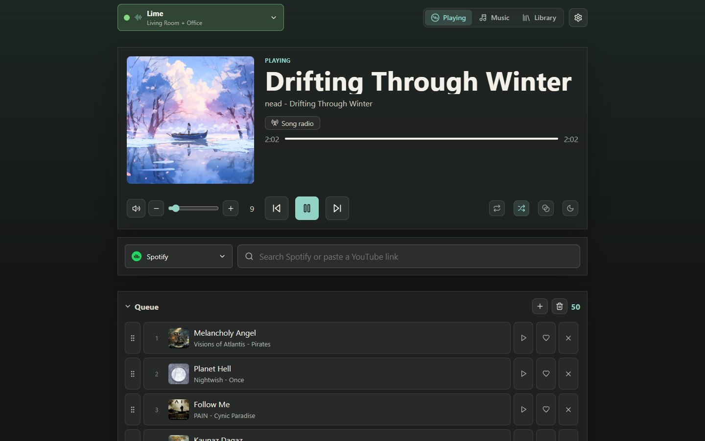
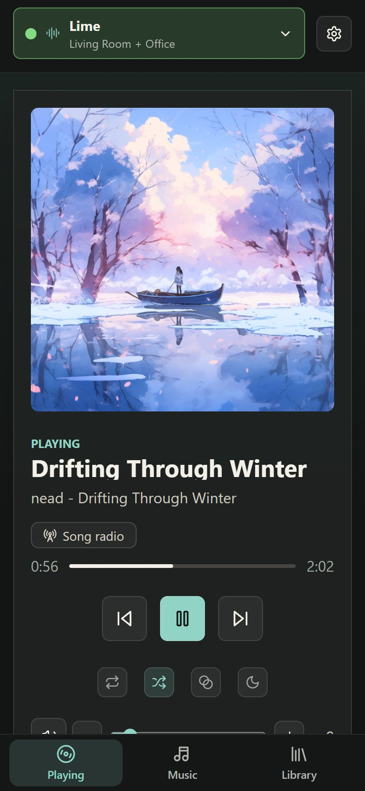
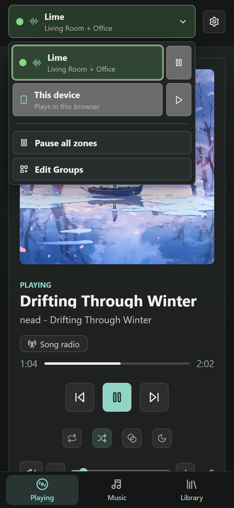
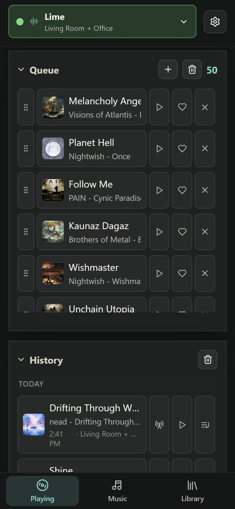
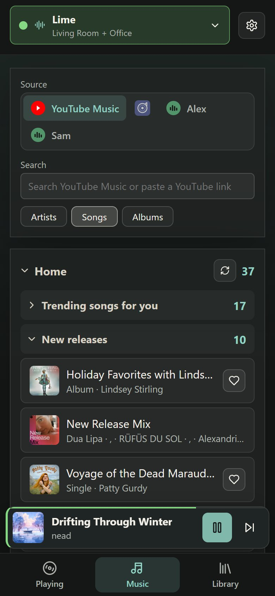
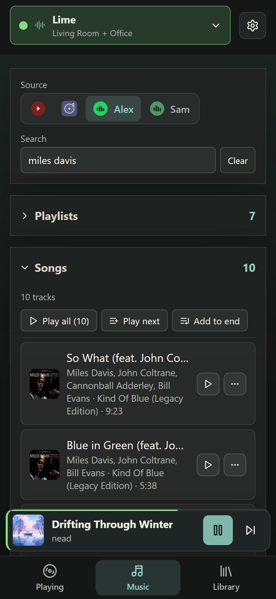
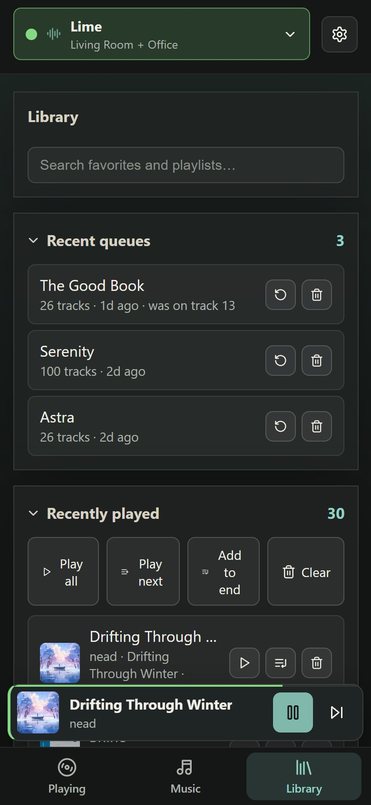
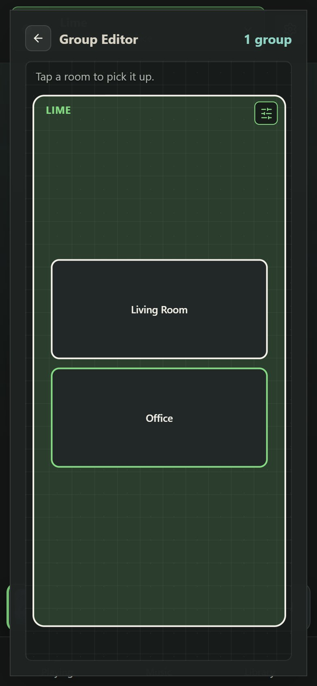
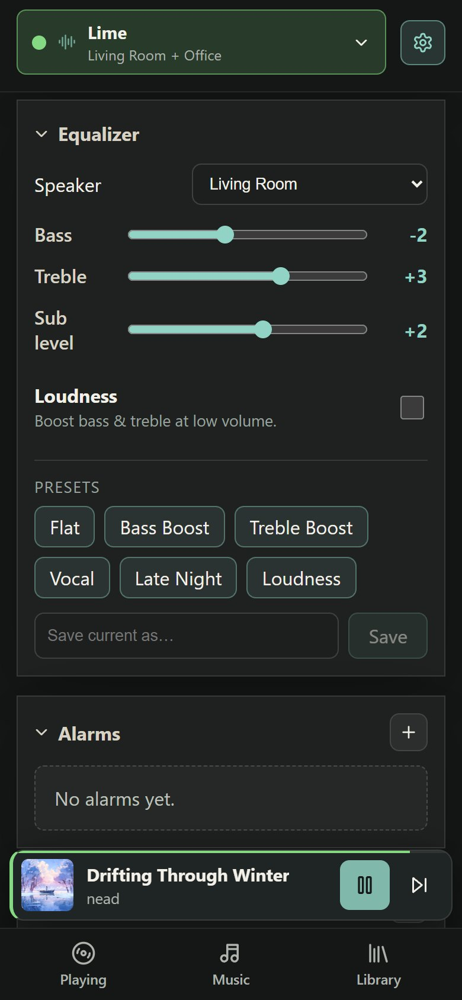
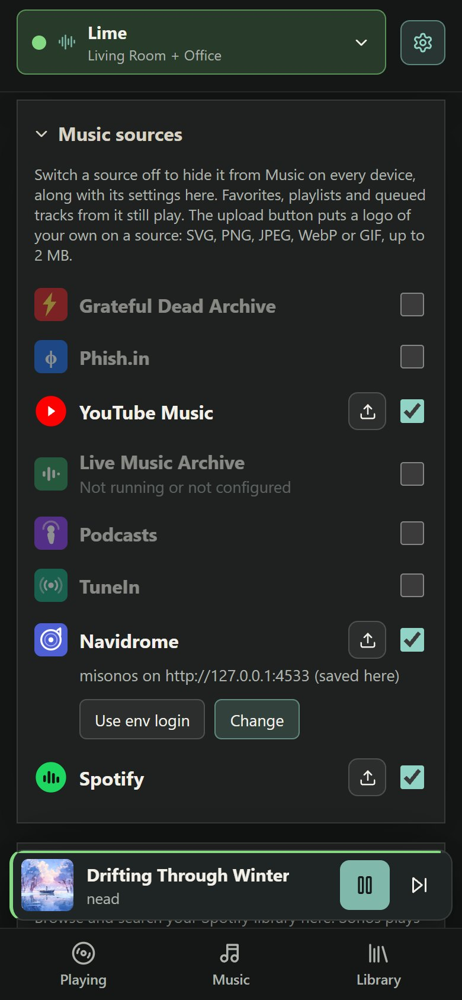

#  MiSonos UX11

A fast Sonos controller for your home network: a phone-first web app (installable as a
PWA) and a small Node bridge that talks to the speakers directly over the LAN, with
music sources of its own.

<p align="center">
  
  &nbsp;&nbsp;&nbsp;&nbsp;
  
  &nbsp;&nbsp;&nbsp;&nbsp;
  
</p>

<p align="center"><em>"If we need that extra push over the cliff, you know what we do?"</em></p>

## Screenshots

<p align="center"></p>

On a phone (see [docs/screenshots](docs/screenshots/README.md)):

| | | |
| :---: | :---: | :---: |
| <br>**Playing** | <br>**Rooms** | <br>**Queue and history** |
| <br>**Music** | <br>**Search** | <br>**Library** |
| <br>**Group editor** | <br>**Equalizer** | <br>**Music sources** |

## What it does

Three screens, **Playing**, **Music** and **Library**, sit in a tab bar along the bottom
of a phone and in the header on a computer. The room menu in the header picks where
everything plays, and the gear opens Settings.

### Playing

- Artwork, progress, transport, repeat, shuffle, crossfade and a sleep timer.
- Volume with −/+ steps. For a group, each room's own volume, and **Even out** to set
  them all to the group's.
- **Song radio**: the playing song, then songs like it, in place of the queue. It also
  starts from any song in Music or History.
- A search box for any source. Paste a YouTube link there to play it right away, or to
  save it into Navidrome's "YouTube" playlist through [Downtify](https://github.com/henriquesebastiao/downtify).
- The **queue** folds away, reorders by dragging, and plays from any row. Tracks can be
  favorited or removed, and the whole queue saved as a playlist.
- **History**: every song any room played, by day, ready to play again or to start a
  radio from.
- Full-screen album art, and the [VU meter](#vu-meter).

### Rooms

The room menu lists each group with its color and its own play/pause button, plus
**This device** (plays in the browser), **Pause all zones** and the **group editor**,
where you drag rooms between groups and pick each group's color.

### Music

- One tab per source, and one per Spotify login in your Sonos app.
- A source's folders (Playlists, Liked Songs, Albums…) are cards that open in place.
  Search results come in sections (Songs, Artists, Albums, Playlists) that fold, and stay
  folded next time.
- Any list has **Play all**, **Play next** and **Add to end**. A song's ⋯ menu adds play
  next, add to end, start radio, favorite and add to a playlist.

### Library

**Recent queues** (put back a queue that something else replaced), **recently played**,
**favorites** by source (radio stations can be presets), MiSonos's own **playlists**
(they resume where you stopped) and a source's playlists as a grid, all searchable and
each in a card that folds.

### Settings

Equalizer (bass, treble, loudness, Sub level, presets), alarms, About My Sonos System,
music sources on or off (with logos of your own), Spotify logins, YouTube Music sign-in
and the Downtify link, the order of folders and search sections in Music, other MiSonos
servers to switch to, and preferences such as a maximum volume.

### Keyboard

Nearly everything has a key: Space plays or pauses, ↑/↓ change the volume, G picks the
next room, B, L and `,` open Music, Library and Settings, `/` searches, and `?` lists the
rest. On Windows, [`scripts/windows/misonos-media-keys.ahk`](scripts/windows/README.md)
sends the keyboard's volume knob and media keys to the selected room.

When a new version is deployed, open apps offer to reload into it.

## VU meter

<p align="center"></p>

Tap the gauge badge on the album art for a full-screen, vintage-hi-fi **VU meter**.
It's pure SVG, so it scales crisply to any display — it looks especially good on an
iPad propped on a stand while a queue plays in the background. The needles follow
the **real** signal (not a canned animation), with authentic ballistics: RMS
response, the lazy ~300 ms needle, the −20…+3 dB scale with a red zone past 0 VU,
and peak LEDs.

Sonos exposes no output level, so MiSonos measures the audio itself — without ever
downloading a second copy of the stream:

- **This device** — when playing locally, it taps the already-decoded audio with
  the Web Audio API, so the needles are perfectly in sync with what you hear.
- **Sonos** — the bridge tees the exact bytes it's already proxying to the speaker
  into `ffmpeg`, computes per-channel levels, and streams them to the meter over
  SSE; the client lines them up to the playback position (with a sync-nudge trim).

It only works for audio MiSonos itself plays (the bundled sources). Content Sonos
plays natively (Spotify, AirPlay, line-in) isn't visible to us, so the meter shows
"No signal".

## Architecture

- `apps/web`: React + Vite controller UI.
- `apps/bridge`: local Node TypeScript LAN bridge for SSDP discovery and Sonos SOAP calls.
- `packages/sonos-protocol`: shared Sonos models plus SOAP/DIDL/XML helpers.

### SMAPI source servers

MiSonos bundles its own Sonos Music API (SMAPI) servers under `apps/`, each
exposing a music source to your speakers:

- `apps/grateful-smapi`: Grateful Dead recordings from archive.org. Data comes
  from [`grateful-dead-db`](https://github.com/agtilden/grateful-dead-db). (port 4319)
- `apps/phish-smapi`: Phish shows via [Phish.in](https://phish.in). (port 4320)
- `apps/ytmusic-smapi`: YouTube Music. (port 4321)
- `apps/lma-smapi`: the [Live Music Archive](https://archive.org/details/etree). (port 4322)
- `apps/podcast-smapi`: podcasts (Apple Podcasts directory + Podcast Index). (port 4323)
- `apps/tunein-smapi`: internet radio via the [TuneIn](https://tunein.com/radio/home/) directory. (port 4324)
- `apps/navidrome-smapi`: your own library on [Navidrome](https://www.navidrome.org) or any
  Subsonic-compatible server; Opus and other non-Sonos formats are transcoded on the fly. (port 4325)
- `apps/spotify-smapi`: your Spotify library (playlists, Liked Songs, albums, artists, search) via the
  Spotify Web API, played by the Spotify account linked in the Sonos app. (port 4326)

The web app talks to the bridge through a typed HTTP/SSE API. That boundary keeps the UI decoupled from the transport, so a native LAN transport could replace the local Node bridge without changing the web app.

## Installation

MiSonos runs the whole stack (bridge + SMAPI sources + web PWA) on a host on your LAN. See **[DEPLOY.md](DEPLOY.md)** for the full setup — either Docker on a Linux host or native Node on any host (including macOS).

To install the app to your phone's home screen, you need HTTPS (the PWA service worker won't install over plain `http://`). The simplest way is [Tailscale](https://tailscale.com): on the host, run `tailscale serve --bg <web-port>` (`6173` for Docker, `4173` for native), then open `https://<host>.<tailnet>.ts.net` on your phone and use "Add to Home Screen". See [DEPLOY.md](DEPLOY.md) for details.

## Local Development

```sh
npm install
npm run dev
```

The bridge listens on port `4317` and the web app defaults to `http://127.0.0.1:6173`.

To work on the web app against a MiSonos that's already running (no local bridge or sources), point its dev server there:

```sh
MISONOS_BRIDGE_URL=http://192.168.1.10:6173 npm run dev:web
```
For Sonos event subscriptions, the bridge binds to `0.0.0.0` by default so speakers can reach its callback endpoint.

If multicast discovery is unavailable, set known speakers manually:

```sh
MISONOS_SPEAKER_IPS=192.168.1.101,192.168.1.102 npm run dev:bridge
```

If event subscriptions fail because the bridge chooses the wrong local network interface, set the callback address explicitly:

```sh
MISONOS_CALLBACK_HOST=$(ipconfig getifaddr en0) npm run dev:bridge
```

## Checks

```sh
npm run typecheck
npm run test
npm run build
```

## License

MiSonos is source-available under the [PolyForm Noncommercial License 1.0.0](LICENSE.md):
free to use, modify, and share for any **noncommercial** purpose. See [LICENSE.md](LICENSE.md)
for the full terms and [NOTICE](NOTICE) for attributions and trademark disclaimers.

MiSonos is an independent, fan-made project and is not affiliated with or endorsed by
Sonos, Google/YouTube, Apple, the Internet Archive, TuneIn, or any artist or service
it interoperates with.
